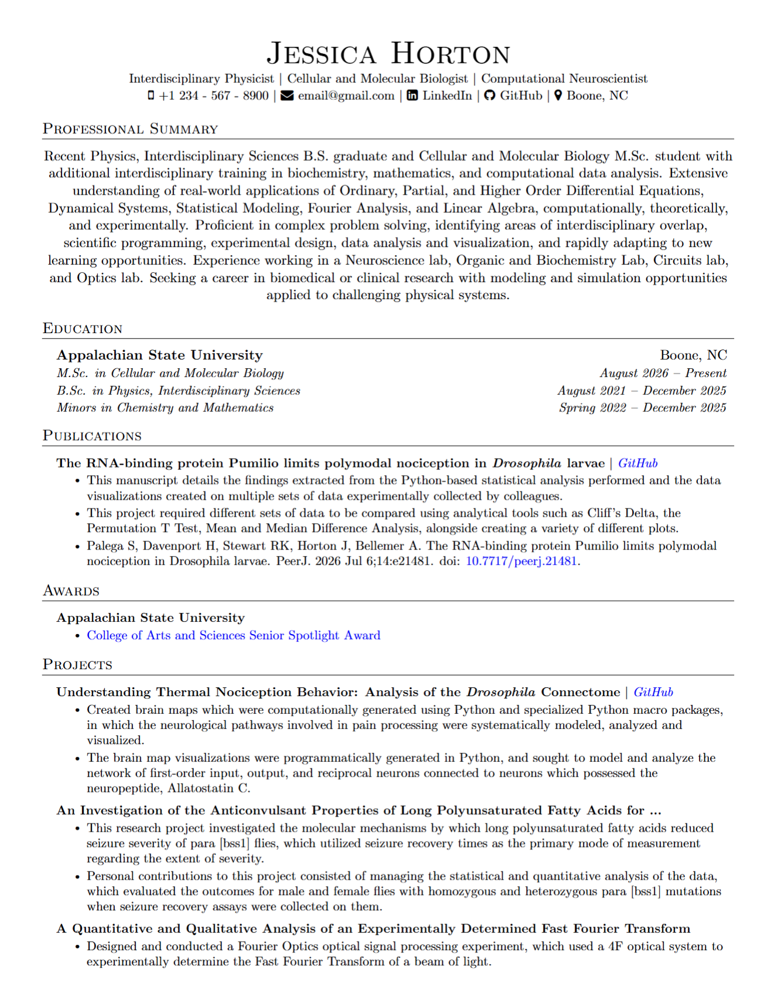
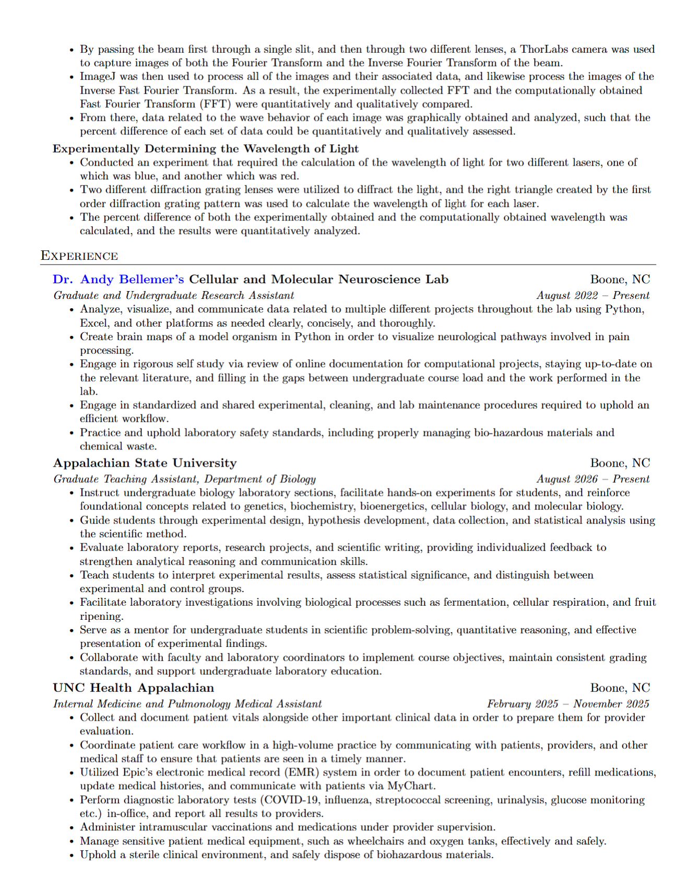

# Jess Horton | Resume

 

To view my resume, click the link titled `Jessica_Horton_Resume.pdf`. All of the source code for this resume can be found in `Jessica_Horton_Resume.tex`, and likewise the original template I modeled my resume off of can be found in `main.tex`. Thanks for taking the time to look at it!

_(For privacy purposes, my phone number and email have been redacted from the public version of this resume. If you would like to contact me, please reach out via [LinkedIn](https://www.linkedin.com/in/jjessicahorton/).)_

# Links
- [Appalachian State's College of Arts and Sciences Senior Spotlight Award](https://cas.appstate.edu/news/cas-senior-spotlight-jess-horton)
- [Understanding Thermal Nociception Behavior: Analysis of the _Drosophila_ Connectome](https://github.com/jjessicahorton/thermal-nociception-connectome)
- [Dr. Andy Bellemer: Appalachian State Department of Biology](https://biology.appstate.edu/directory/dr-andrew-bellemer)

# Screenshots

